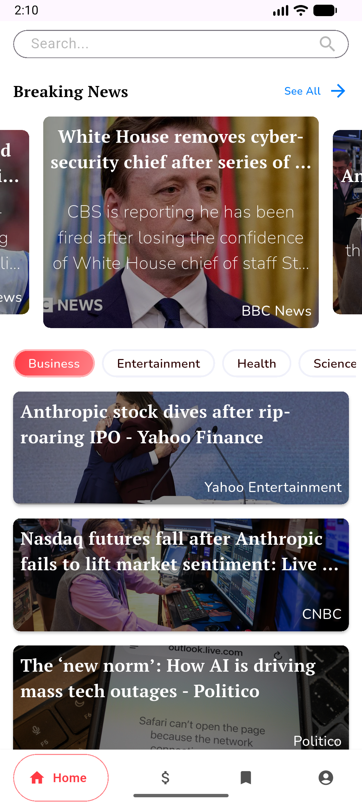
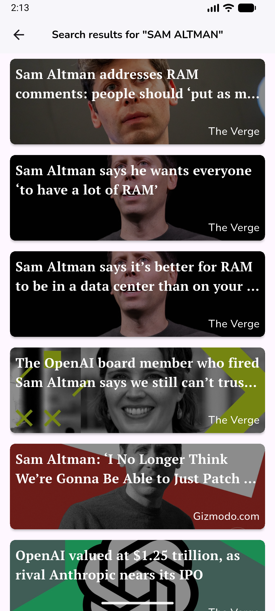
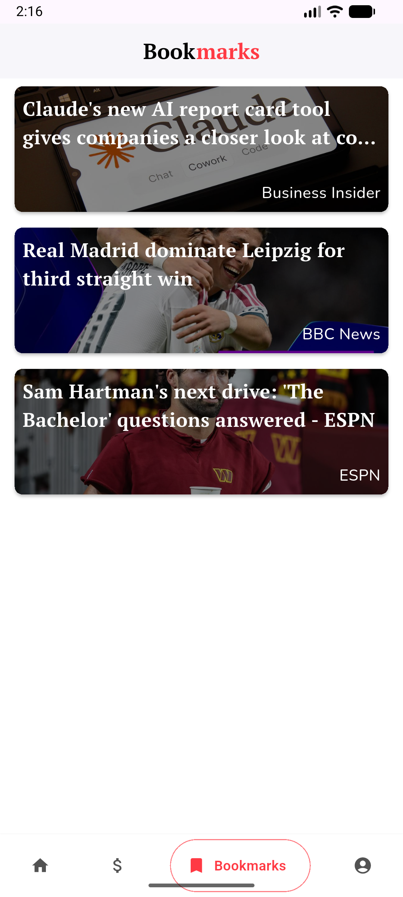
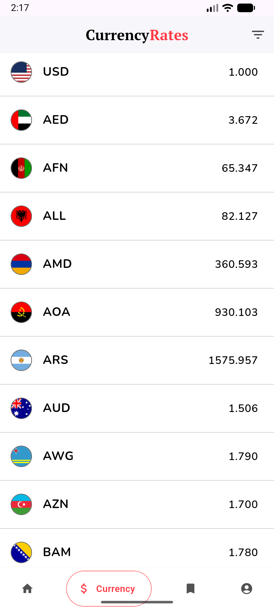
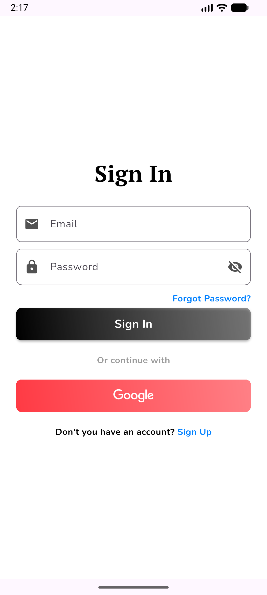

# Beykoz News

A news and currency tracking app built with Flutter. Discover the latest headlines,
browse by topic, read articles in the app, and save them for later.

## Features

- Breaking news and category-based news feeds
- Keyword search
- In-app article reader, link copying, and sharing
- Bookmarks linked to your account
- Exchange rates with base and target currency filters
- Email/password and Google sign-in, email verification, and password reset

## Screenshots

Click any screenshot to view it at full size.

<table>
  <tr>
    <th>Home</th>
    <th>Categories</th>
    <th>Search</th>
  </tr>
  <tr>
    <td><a href="docs/screenshots/home.png"></a></td>
    <td><a href="docs/screenshots/category.png"></a></td>
    <td><a href="docs/screenshots/search.png"></a></td>
  </tr>
  <tr>
    <th>Article Details</th>
    <th>Bookmarks</th>
    <th>Exchange Rates</th>
  </tr>
  <tr>
    <td><a href="docs/screenshots/newdetail.png"></a></td>
    <td><a href="docs/screenshots/bookmarks.png"></a></td>
    <td><a href="docs/screenshots/currency.png"></a></td>
  </tr>
  <tr>
    <th colspan="3">Sign In</th>
  </tr>
  <tr>
    <td colspan="3" align="center"><a href="docs/screenshots/auth.png"></a></td>
  </tr>
</table>

## Tech Stack

| Area | Technology |
| --- | --- |
| App | Flutter / Dart |
| Authentication | Firebase Authentication, Google Sign-In |
| Bookmarks | Cloud Firestore |
| News data | NewsAPI |
| Exchange rate data | ExchangeRate-API |
| Article reader | WebView |
| Local configuration | flutter_dotenv |

## Requirements

Verified Android development environment: **Flutter 3.50.1 / Dart 3.14**,
Gradle 9.5, and Android SDK 37. The minimum supported Android API level is 24.
You need Android Studio, the Android SDK, and an emulator or a device with USB debugging enabled.

## Getting Started

1. Clone the repository or download it as a ZIP, then open the project folder.
2. Run `flutter doctor -v` to check your development environment.
3. Configure your own Firebase project as described below.
4. Copy `.env.example` to `.env` in the project root.
   Do not overwrite an existing `.env` file.

   PowerShell:

   ```powershell
   Copy-Item .env.example .env
   ```

   macOS / Linux:

   ```sh
   cp .env.example .env
   ```

5. Add your own API keys to `.env`.
6. Install dependencies and run the app:

   ```sh
   flutter pub get
   flutter devices
   flutter run
   ```

In VS Code, choose your device using **Flutter: Select Device**, then press **F5**.
You can start an Android emulator from Android Studio's Device Manager.

## API Keys

**Everyone running this project must provide their own NewsAPI and ExchangeRate-API keys.**
Create an account with each service, obtain your API keys, and add them to `.env`:

```dotenv
NEWS_API_KEY=your_newsapi_key
CURRENCY_API_KEY=your_exchangerate_api_key
```

Quotes are not required. Do not add commas or semicolons at the end of the lines.
Keys are loaded using `flutter_dotenv`; they are not stored in Dart source files.
Git ignores `.env`; the repository includes only `.env.example` with empty fields.

The app can launch with empty keys, but the news and currency screens will display
missing configuration messages. Stop and restart the app after changing the keys.
Service quotas and usage terms depend on your own accounts.

> The `.env` file is bundled with the app as a Flutter asset.
> Keeping it out of Git does not keep its contents secret on a device. In production,
> route requests through your own backend to protect private service credentials.

## Firebase Setup

**Connect your own Firebase project** instead of using the repository's Firebase
configuration for your app. Adding news and exchange rate API keys does not replace
Firebase setup.

- Create a Firebase project and register your app for the target platform.
- Generate the FlutterFire configuration for your project. Update
  `lib/firebase_options.dart` and the platform configuration files to match your project.
  The Android configuration is stored in `android/app/google-services.json`.
- Enable the **Email/Password** and **Google** providers in Authentication.
- For Google sign-in on Android, add your signing certificate's SHA fingerprints
  to Firebase and update the Android configuration.
- Create a Cloud Firestore database. Documents in the `bookmarks` collection use
  a `userId` field. Configure security rules so users can only read and modify
  their own bookmarks. Do not leave the database publicly accessible.

## Validation

```sh
flutter analyze
flutter test
flutter build apk --debug
```

Tests cover missing-key screens without endless loading, search query encoding,
and API error handling. The Android debug APK build and app launch on an emulator
have been verified. Test sign-in, news feeds, and bookmarks with your own service
configuration as well.

iOS/macOS have not been verified in this Windows environment; building for them
requires a Mac and Xcode. The presence of other platform folders does not mean
all features work on those platforms.
